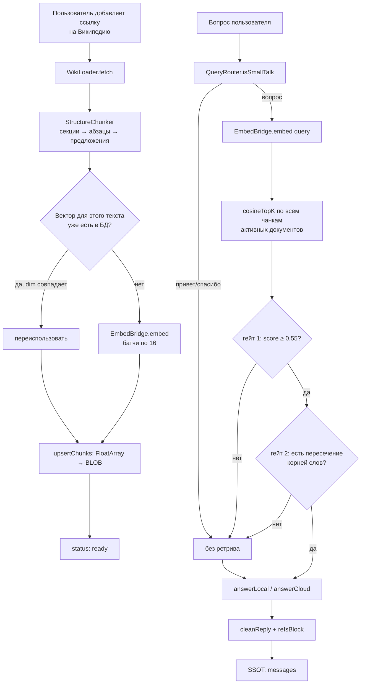

# 06. RAG-пайплайн

Реализация целиком в [`shared/src/task3/data/RagRepository.kt`](../shared/src/task3/data/RagRepository.kt)
с вспомогательными чистыми функциями рядом. Ниже — каждый этап.

## Общая схема



## Этап 1. Загрузка документа

**Вход:** строка от пользователя — полная ссылка `https://ru.wikipedia.org/wiki/Ворона`
или просто название статьи.

**`WikiLoader.parseInput(input, defaultLang = "ru")`**

* Ссылка разбирается регуляркой `https?://([a-z-]+)\.wikipedia\.org/wiki/([^#?]+)`;
  язык и заголовок извлекаются из неё, `_` заменяется пробелом, `%XX` декодируется
  собственной функцией `urlDecode` (без `java.net`, чтобы код остался в common).
* Без ссылки: `lang = "ru"`, заголовок — ввод пользователя без префикса протокола.

**`WikiLoader.fetch`**

```
GET https://{lang}.wikipedia.org/w/api.php
    ?action=query
    &prop=extracts
    &explaintext=1
    &exsectionformat=wiki
    &redirects=1
    &format=json
    &titles={urlEncode(title)}
```

* Транспорт — общий `httpGet` из `Network.kt`.
* Ошибки превращаются в понятные сообщения: `Нет связи с Wikipedia: …`,
  `Wikipedia вернула не-JSON`, `Пустой ответ Wikipedia API`,
  `Статья не найдена: …`, `В статье нет текста (возможно, редирект/список)`.
* Успех даёт `RawDoc(source = "wikipedia/{lang}/{title}", title = "{title} (wikipedia)", text = extract)`.
* `exsectionformat=wiki` даёт заголовки секций в виде `=== Раздел ===` — их потом
  разбирает `StructureChunker`.

## Этап 2. Структурный чанкинг

`StructureChunker(maxChars = 1000, minChars = 50)`. Схема: **статья → секции →
абзацы с тегом секции**. Единственная стратегия (в Week 4 их было две,
второй индекс отброшен ради памяти на телефоне).

1. **Деление на секции.** Ищутся заголовки двух видов:
   * Markdown: `^(#{1,4})\s+(.*)`
   * Wiki: `^={2,4}\s*(.+?)\s*={2,4}\s*$`

   Заголовок начинает новую секцию только если уже накоплено **больше 200 символов**
   (иначе первые строки статьи были бы «шапкой» без контекста).
   Если заголовков нет — включается эвристика «псевдо-заголовков»: блок из одной
   строки длиной 2..80 символов, заканчивающийся не точкой, за которым идёт длинный
   блок (это типичные wiki-лиды). Если и это не сработало (меньше трёх блоков) —
   весь текст одной секцией.
2. **Деление секции на абзацы** — по пустым строкам; абзацы короче `minChars` (50) отбрасываются.
3. **Тегирование секцией** (`withSection`): абзац получает заголовок секции первой строкой,
   чтобы чанк был самодостаточным и в векторе, и в промпте. Если заголовок уже совпадает
   с первой строкой абзаца (после снятия `#`/`=`), дублирования не будет.
   Секции `""`, `(начало)`, `(весь файл)` считаются безымянными — тег не добавляется.
4. **Деление длинных абзацев** (`splitLongParagraph`): только по границам предложений
   регуляркой `.+?[.!?…]+\s*|.+` (жадный шаблон без lookbehind — для переносимости
   в common-коде), предложения упаковываются плотно до `maxChars`.
   Если предложение длиннее `maxChars` — аварийное деление по словам (`splitByWords`).
   Фиксированных окон и перекрытий нет.

**Почему 1000 символов?** Эмбеддинг-модель имеет `maxInputLength = 512` токенов.
Русский текст токенизируется плотно (~2–3 символа на токен), 1000 символов — это
примерно 400 токенов; при 1000 символах хвост регулярно обрезался нативным кодом.

**Идентификаторы:** `chunkId(doc, ord) = "{source}#{ord}"`, а в БД ключ — `"{chunkId}#{embId}"`,
то есть смена embedding-модели не конфликтует со старыми строками.

## Этап 3. Эмбеддинги

**`EmbedBridge`** (`shared/src/task3/llama/EmbedBridge.kt`):

```kotlin
interface EmbedBridge {
    val isReady: Boolean
    val dim: Int                       // фактическая размерность, узнаётся пробой
    suspend fun load(modelPath: String, nThreads: Int = 4)
    suspend fun embed(texts: List<String>): List<FloatArray>
    fun close()
}
```

* **Android**: `LiteRtEmbedBridge` — `EmbeddingEngine` из LiteRT-LM, бэкенд всегда
  `Backend.CPU()`, `maxInputLength = 512`, `EmbeddingOptions(normalize = true)`
  (нормализация нужна, потому что поиск считает косинус как dot product).
  Токенизатор внутри бандла — ручной BPE не нужен.
* **Desktop**: `FakeEmbedBridge` — `hashingEmbed` (хеширование символьных триграмм
  в `dim` из каталога, 768). Векторы детерминированные, но **смысловые** — качество
  поиска на десктопе нерелевантно, зато UI индексации работает.

**Размерность — источник истины.** `dim` в `EmbedCatalog` (768) — только для подписи
в UI. Настоящее значение узнаётся пробой при загрузке:

```kotlin
modelDim = e.computeEmbedding(listOf(InputData.Text("проверка"))).embedding.size
```

Каждый чанк хранит собственный `dim`, а поиск фильтрует `it.dim == embBridge.dim` —
это защищает от сравнения векторов разной размерности.

**Переиспользование векторов.** Перед расчётом для каждого чанка выполняется
`dao.findVectorByText(text)`; если строка найдена и `stored.dim == embBridge.dim`,
вектор берётся из БД. Так повторная индексация той же статьи не тратит время на
эмбеддинги.

**Батчинг.** Недостающие тексты режутся по 16 (`missing.chunked(16)`), прогресс
пишется в `_indexProgress[source]` как доля 0..1. Размер батча ограничен памятью
мобильного устройства и скоростью CPU-инференса.

**Префиксы.** `EmbedModel.docPrefix` / `queryPrefix` пустые — EmbeddingGemma
не требует `search_document:` / `search_query:`. Поля оставлены в каталоге как
точка расширения для других моделей.

## Этап 4. Поиск

`RagRepository.retrieve(query, topK = 5)`:

1. Проверка готовности эмбеддингов; если не готовы — попытка `ensureEmbedLoaded`.
2. **Фильтрация кандидатов:**
   ```kotlin
   val activeDocs = dao.allDocs().filter { it.active }.map { it.source }.toSet()
   val all = dao.allChunks().filter { it.source in activeDocs && it.dim == embBridge.dim }
   ```
   Выключенный переключателем документ полностью исключается из поиска.
3. Вектор запроса: `embBridge.embed(listOf(emb.queryPrefix + query)).first()`.
4. **`cosineTopK(q, candidates, topK)`** — точный перебор: поскольку векторы уже
   L2-нормализованы, косинус = скалярное произведение. Сортировка по убыванию,
   обрезка до `topK`. Индексов/ANN-структур нет намеренно: на несколько сотен
   чанков полный перебор быстрее и предсказуемее.
5. `_lastMaxScore` — максимальный косинус последнего запроса, диагностика для демо.
6. **Гейт 1 — порог:** `scored.filter { it.second >= MIN_SCORE }`, где
   `MIN_SCORE = 0.55f`. Без порога запрос вне темы («дрозды» по базе про воронов)
   получал 5 мусорных чанков и вынужденный отказ.
7. **Гейт 2 — пересечение корней:**
   ```kotlin
   val stems = query.lowercase()
       .split(Regex("[^а-яa-zё]+"))
       .filter { it.length >= 4 }
       .map { it.take(5) }.toSet()
   return hits.any { h -> stems.any { s -> s in h.text.lowercase() } }
   ```
   Грубая, но дешёвая гибридная проверка: если ни один корень длиной ≥ 4
   (обрезанный до 5 символов) не встречается в top-хитах, запрос не про эту базу —
   тоже промах. Пустой набор корней (запрос из коротких слов) **не считается промахом**.

## Этап 5. Маршрутизация запроса

`QueryRouter.isSmallTalk(query)` — список из 17 регулярных выражений (приветствия,
«как дела», благодарности, прощания, `hi`/`hello`/`thanks`/`bye`, `how are you`).
Совпадение целиком (`Regex.matches`), не подстрока: `«привет, расскажи про воронов»`
проверку **не проходит** (это зафиксировано тестом).

Смысл: не запускать EmbeddingGemma и не скармливать модели мусорный контекст.

## Этап 6. Формирование ответа

### Локальная модель (`answerLocal`)

```kotlin
if (context.isEmpty()) {
    // пустой контекст: либо small-talk, либо запрос вне базы
    system = PromptBuilder.chatSystem() + preset.styleHint + hint
    user   = PromptBuilder.chatUser(history.takeLast(6), query)
} else {
    system = PromptBuilder.ragSystem(context.size) + preset.styleHint
    user   = PromptBuilder.chatUser(
        history.takeLast(6),
        "Контекст:\n${contextBlock(context, perHit = 600)}\n\nВопрос: $query",
    )
}
```

* `contextBlock` печатает `[i] Заголовок / Секция:\n<текст до 600 символов>` —
  это те же номера, что потом попадут в блок «Источники».
* Для RAG-режима история урезается до **6** сообщений (в базовом чате — 10):
  маленькая модель с KV 1280–4096 не влезет в полный контекст.
* **Фаза 4 — подсказка про базу.** Если контекст пуст, но документы есть
  (значит запрос вне темы, а не small-talk), в системный промпт добавляется
  `В локальной базе есть документы: …` с просьбой ответить по общим знаниям и
  предложить спросить про документы из списка. Это превращает сухое «в документах
  этого нет» в полезный ответ.
* Пресет влияет и на сэмплер (`GenPreset.toGenParams()`), и на `styleHint`,
  который подмешивается в системный промпт: на маленькой модели разница
  температуры почти не видна, а подсказка стиля видна сразу.

### Облако (`answerCloud`)

* Требует непустой API-ключ, иначе `Нет API-ключа DeepSeek — задай его в Настройках`.
* Системный промпт: `Ты полезный ассистент.` без контекста либо `ragSystem(n)`.
* История — до 12 сообщений в ролях `user`/`assistant`.
* Результат `DeepSeekResult` (Ok / HttpError / NetworkError) **не бросается**,
  а превращается в текст ответа — облачный сбой не должен ломать чат.

### Постобработка

```kotlin
PromptBuilder.cleanReply(acc)   // вырезает <think>…</think> и служебные маркеры
    .ifEmpty { acc.trim() }
    .ifEmpty { "(пустой ответ)" }
    + refsBlock(context)        // "\n\nИсточники:\n[1] …"
```

`cleanReply` — чистая функция, покрыта тестами:

* полный блок `<think>…</think>` (regex `[\s\S]*?`);
* незакрытый `<think>` в хвосте — всё после него отбрасывается (модель оборвалась);
* хвосты `<|im_end|>`, `<|im_start|>`, `<|endoftext|>` — если модель проэхоировала промпт.

## Пресеты генерации

`GenPreset` (`task3.domain`) — сам сэмплер плюс подсказка стиля:

| id | Название | temperature | topK | topP | styleHint (сокращённо) |
|---|---|---|---|---|---|
| `precise` | Точный | 0.2 | 20 | 0.8 | кратко, 1-3 предложения, только проверенные факты |
| `balanced` | Баланс (по умолчанию) | 0.5 | 40 | 0.9 | живо и по делу, 2-4 предложения |
| `creative` | Живой | 0.8 | 60 | 0.95 | развёрнуто, 3-6 предложений, можно дополнять общими знаниями |

Пресет хранится в `settings` под ключом `gen_preset` и переживает перезапуск.

## Системные промпты

`PromptBuilder` (`shared/src/task2/data/PromptBuilder.kt`) — единственное место,
где формируются промпты.

**`chatSystem(facts)`** — базовый промпт собеседника + блок фактов:

```
Ты — дружелюбный офлайн-собеседник на телефоне. Всегда отвечай на том же языке,
на котором написано последнее сообщение пользователя. … Если в блоке фактов есть
имя — обращайся по имени иногда, не в каждом сообщении. …

Факты о собеседнике (учитывай в ответах):
- Имя пользователя — Влад
- Нравится: кофе
```

Ключевое: язык **не зашит** — он определяется по диалогу, русский только как фолбэк.
Маркеры ChatML в промптах **отсутствуют**: шаблон применяет сам LiteRT-LM.

**`ragSystem(n)`** — RAG-режим:

```
Ты отвечаешь на вопросы по локальной базе знаний. Если вопрос по теме фрагментов
[1..n] — опирайся на них, после каждого факта ставь короткую ссылку вида [1].
Не выдумывай факты и цитаты из базы. Смол-ток … и вопросы без связи с базой —
отвечай свободно и дружелюбно, 1-3 предложения, без ссылок. Если по существу
вопроса во фрагментах ничего нет — честно скажи, что в документах этого нет,
и предложи переформулировать.
```

Комментарий в коде фиксирует важную историю: раньше промпт был жёстким
«ONLY from fragments», и на «привет» модель отвечала «в документах этого нет».
Теперь small-talk обрабатывается свободно.

**`chatUser(history, userPrompt, maxMessages = 10)`** — скользящее окно:

```
Пользователь: …
Ассистент: …
…
Пользователь: <текущий вопрос>
```

Окно в 10 сообщений защищает KV-кэш маленькой модели: старые реплики вытесняются.

## Долговременная память (базовый чат, `task2`)

Работает только в `ChatRepositoryImpl`, не в RAG-режиме.

* `FactExtractor.extractFrom(text)` — регулярки RU+EN по три группам:
  * имя: `меня зовут X`, `моё имя X`, `my name is X`, `I'm X`, `I am X`;
  * предпочтения: `я люблю …`, `мне нравится …`, `я обожаю …`, `i love/like …`;
  * запоминание: `запомни …`, `remember …`.
* Фильтры шума: `NAME_STOP` (`fine`, `ok`, `tired`, … — отсекает «I'm fine»),
  `PRONOUN_STOP` (короткие местоимения вроде «it» — не факт),
  минимальная длина 2 символа.
* Ограничения: не больше 3 фактов за реплику, длина факта ≤ 120 символов,
  вход обрезается до 300 символов.
* `RoomMemoryStore` держит максимум **20** фактов (`trimFacts`), дедуплицирует
  регистронезависимо и по вхождению подстроки (`sameFact`).
* Факты извлекаются **до** генерации, синхронно и мгновенно — текущий ответ уже
  может обратиться по имени, которое только что назвали.

Почему не LLM-извлечение: проверено на устройстве — маленькие модели игнорируют
мета-инструкции («перечисли факты или ответь NO») и отвечают «I am a helpful assistant».
Правила для такой модели надёжнее: мгновенно, бесплатно, предсказуемо, тестируемо.
Шов под будущий LLM-извлекатель сохранён: `MemoryStore` ничего не знает об источнике фактов
(поле `FactEntity.source` и миграция v1→v2 — задел под это).
